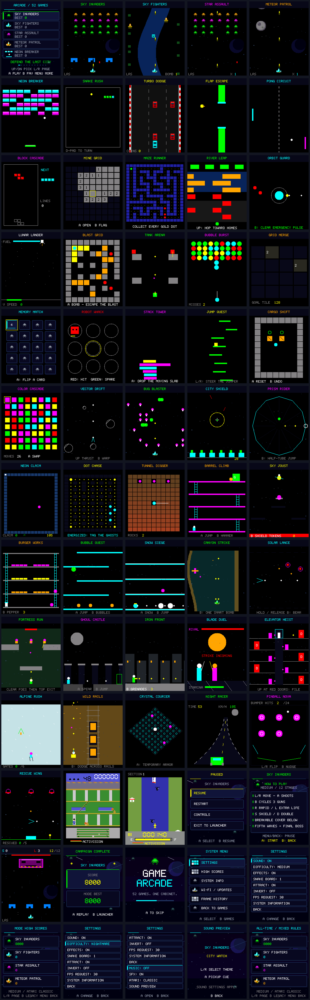
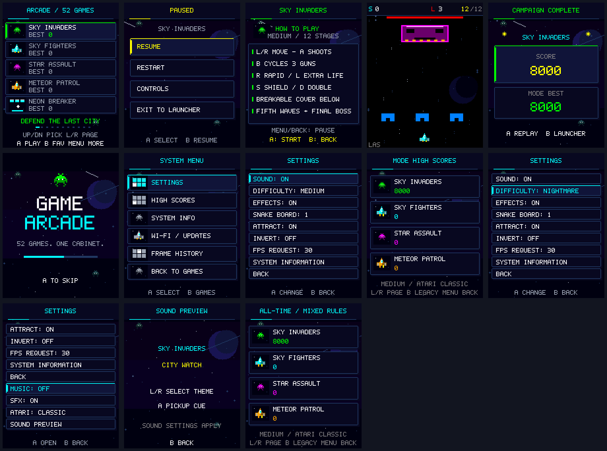
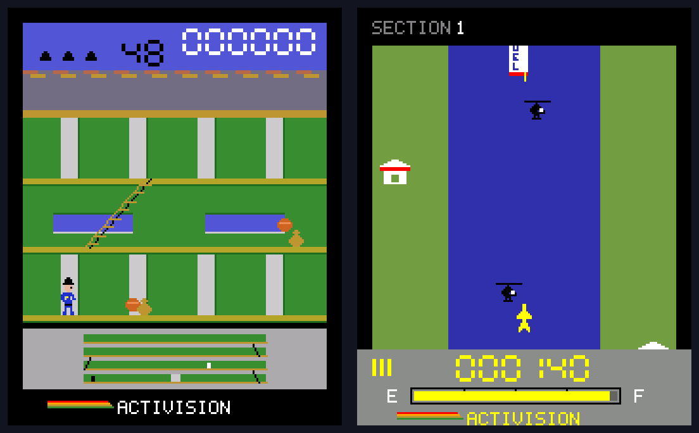

# Game Arcade — ESP32-WROVER and ESP32-WROOM

52 native arcade games on a 176×220 ILI9225 display, with eight buttons, passive-buzzer audio,
favorites, saved scores, difficulty settings, pause/restart menus, and a PSRAM-backed frame history.
Wi-Fi setup runs on demand; firmware updates come from
[ashkan89/esp32-arcade releases](https://github.com/ashkan89/esp32-arcade/releases).
WROOM builds support 4 MB or 16 MB flash without PSRAM, with all 52 games and firmware updates.
They use an RGB332 framebuffer; frame history requires the WROVER PSRAM build.



The space-themed interface uses illustrated game thumbnails, accent selection cards,
favorite stars, page indicators, and consistent menus for controls, settings, scores,
pause, and results. Original procedural pixel artwork adds shaded spacecraft, animated
aliens, meteor craters, detailed cars, beveled puzzle tiles, and a snake with directional eyes.
Planets, parallax stars, and shooting stars animate behind menus; gameplay backgrounds
use dim stars to preserve target visibility. **Settings → Effects → Reduced** freezes
the new decorative motion and disables projectile trails. These assets allocate no heap
memory and work with both RGB565 and the RGB332 framebuffer fallback.



Generate previews from the real C++ renderer with `python scripts/test_host.py`,
then `python scripts/preview.py` and `python scripts/preview.py --menus`.
Physical display legibility and frame timing still require device verification.

## Build and first upload

```sh
python -m pip install platformio==6.2.0
pio run -e release
pio run -e debug
pio run -e wroom-4mb
pio run -e wroom-16mb
pio run -e release -t upload --upload-port YOUR_PORT
pio device monitor --port YOUR_PORT --baud 115200
```

Rewire to [the new pin map](docs/HARDWARE.md) before running this firmware. The first upload
must use USB/serial so the rollback-enabled bootloader and A/B partition table are installed.
Select `release`/`debug` for WROVER N16R8, `wroom-4mb` for WROOM with 4 MB flash,
or `wroom-16mb` for WROOM with 16 MB flash. Upload using that same environment.
All builds use the same display and button wiring. Startup checks detected capacities;
wrong memory hardware stops startup and rejects a pending OTA boot.
See [WROOM memory analysis and acceptance checks](docs/WROOM.md).

## Controls

| Button | Menus | Games |
| --- | --- | --- |
| Up / Down | Select game or menu row | Movement / game-specific action |
| Left / Right | Launcher page; menu navigation | Movement / aiming |
| A | Confirm / play | Main action |
| B | Toggle launcher favorite; back elsewhere | Secondary action |
| Menu | System menu; pause/resume | Pause menu |
| Back | System menu / back | Pause menu with exit option |

Each game has its own controls screen. Scores and favorites save when outside gameplay.
Choose **Easy, Medium, Hard, or Nightmare** in **Menu → Settings → Difficulty**.
Medium is the previous Normal setting. All tiers now apply more pressure; Nightmare adds
faster hazards, shorter attack/recovery windows and fewer lives where the game uses lives.
Puzzles instead tighten mine density, move/undo budgets, board generation or deadlines.
Difficulty takes effect when starting or restarting a run; existing scores and favorites remain saved.
Settings also provide independent **Music** and **SFX** switches and a **Sound Preview** for all
52 game tracks plus the menu theme. Atari games default to **Classic**; select **Enhanced**
for committed thief reactions, timed floor navigation and validated river routes. New personal bests are separated
by difficulty and Atari mode. In High Scores, **B** toggles the preserved all-time mixed records;
**Menu/Back** returns.

The [52-game audit](docs/GAMEPLAY_AUDIT.md), [audio guide and track map](docs/AUDIO_GUIDE.md),
[research notes](docs/RESEARCH_NOTES.md), and [build/test results](docs/BUILD_AND_TEST.md)
document these gameplay and audio changes and the physical checks still pending.
Attract mode starts after 20 seconds idle and never records scores.
The last-run history holds up to 40 sampled frames (one every 250 ms), using banked PSRAM.
It is a visual history, not a replay of game inputs.

## Games

| Shooters / combat | Action / reflex | Puzzles / strategy |
| --- | --- | --- |
| Sky Invaders | Neon Breaker | Block Cascade |
| Sky Fighters | Snake Rush | Mine Grid |
| Star Assault | Turbo Dodge | Grid Merge |
| Meteor Patrol | Flap Escape | Memory Match |
| Orbit Guard | Pong Circuit | Cargo Shift |
| Tank Arena | River Leap | Color Cascade |
| Blast Grid | Lunar Lander | |
| Bubble Burst | Robot Whack | |
| | Stack Tower | |
| | Jump Quest | |
| | Maze Runner | |

The 25 additions are Vector Drift, Bug Blaster, City Shield, Prism Rider, Neon Claim,
Dot Chase, Tunnel Digger, Barrel Climb, Sky Joust, Burger Works, Bubble Quest, Snow Siege,
Canyon Strike, Solar Lance, Fortress Run, Ghoul Castle, Iron Front, Blade Duel,
Elevator Heist, Alpine Rush, Wild Rails, Crystal Courier, Night Racer, Pinball Nova,
and Rescue Wing. Each lives in its own source file with its own game rules.

The original 50 games have twelve stages and a **Campaign Complete** ending with a score bonus.
Combat games include bosses; puzzle, territory and racing campaigns finish their own
objectives. Read the [complete game guide](docs/GAMES.md) for stage objectives and boss
schedules, and [web research](docs/GAME_REFERENCES.md) for the 25 classic inspirations.
The additions use original code and procedural artwork, with their own titles and rules.

**Keystone Kapers** and **River Raid** are now available as separate native recreations
in slots 50 and 51. They use Atari-style pixel graphics and their own HUDs, and continue
as score attacks beyond twelve rounds. Keystone includes the mall, lift, upward escalators,
security map and timed chase. River Raid includes fuel, ships, helicopters, jets, bridges,
checkpoint retries and 48 difficulty states. These are reconstructed ports, with known
differences from the cartridges; see [research, controls and fidelity limits](docs/ATARI_RESEARCH.md).



[View twelve gameplay and graphics review scenes](artifacts/atari-states.png),
including lift travel, jump/duck poses, rooftop pursuit, river islands and bridge destruction.

## Wi-Fi and firmware updates

Open **Menu → Wi-Fi / Firmware Update → Wi-Fi / Repository Setup**. Join `GameArcade-Setup`
using the random key shown on the display, then open `http://192.168.4.1/`.
Enter the key exactly as shown, using uppercase letters. If your phone opens a Wi-Fi sign-in
page, use that page; otherwise open the address manually and stay connected when warned
that the setup network has no internet. Keep the console on the update menu during setup.
Enter your Wi-Fi name/password and `ashkan89/esp32-arcade` (or another public repository).
Setup supports WPA/WPA2 personal credentials, with an 8–63 character password. Credentials
stay on the console in NVS; they are never added to source or printed on serial.

Choose **Check GitHub Release**, then **Install Verified Update** if a newer stable version
is available. Wi-Fi runs during setup/check/install and shuts off afterwards. The application
downloads to the inactive slot (1984 KiB on 4 MB WROOM, 3 MiB on 16 MB targets);
HTTPS, SHA-256, size, board identity, version and ESP image
validation must pass before boot selection changes. A pending firmware must pass startup
checks and eight seconds of functioning UI before acceptance. Failure/reset before acceptance
returns to the previous healthy slot. The update menu also offers explicit previous-firmware boot.

See [OTA details and release instructions](docs/OTA.md),
[adding a game](docs/ARCHITECTURE.md), and [verification](docs/VERIFICATION.md).

```sh
python scripts/verify.py
python scripts/package_release.py
```

For the next firmware release, increase `VERSION`, commit, create the matching `vX.Y.Z` tag,
and push it. The GitHub workflow builds all four environments, runs host tests, and publishes the
application binary, manifest, initial-flash image and checksums.

Boot was verified on a physical ESP32 via COM5: 16 MB flash, 8 MB PSRAM, 40 banked-history
slots and successful boot-health confirmation, with no serial errors during a 35-second capture.
Buttons, sound, Wi-Fi provisioning, history capture/playback and power-loss/rollback still need the
[hardware acceptance checks](docs/HARDWARE_CHECKLIST.md).
