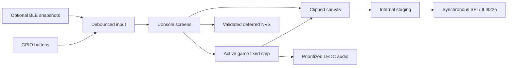

# Architecture and adding games

`include/BoardConfig.h` is the single pin/display configuration. PlatformIO injects it into
library compilation so TFT_eSPI cannot silently use another machine's Arduino setup.
`platformio.ini` selects the classic ESP32 board, exact framework/library versions, and
feature environments; `partitions_16mb.csv` reserves NVS and two 3 MB applications, with the
remaining flash intentionally unallocated. No filesystem assets or OTA service are needed.

## Modules

| Module | Responsibility |
| --- | --- |
| `Core` | Rollover-safe time, fixed steps, RNG, AABB/swept collisions, fixed pools, debounce, validated settings serialization |
| `Canvas` | Clipped RGB565/RGB332 primitives, original compact font, sprite drawing; pure C++ |
| `Game` | Initialize/start/input/update/render/pause/resume/cleanup contract and options |
| `Console` | Registry selection, screens, instructions, pause/restart, scores, settings, attract demo |
| `Hardware::Display` | TFT ownership, allocation tiers, internal staging, measured tile/strip crossover |
| `Hardware::Audio` | One LEDC channel, prioritized finite effects, rollover-safe note deadlines, menu melody |
| `Hardware::Storage` | One versioned NVS blob, legacy import, deferred/retried writes |
| `Hardware::Diagnostics` | Physical/configured memory, reset reasons, timing buckets, heap/latency reporting |
| `Controller` | Optional BLE discovery in menus; atomic input snapshots; no rendering from callbacks |
| `Shooters` | Shared bounded entities and four distinct shooter rule sets |
| `ArcadeGames` | Independent paddle, snake, racing, and flap rules |
| `Registry` | Titles, descriptions, instructions, colors, icons, minimum input capability, game instances |
| `main.cpp` | Single peripheral owner, cooperative input/audio service, simulation/render scheduling |

Rules and menus include no Arduino headers. Host tests compile their real implementations,
not rewritten models. Game instances use static storage; pools clear on switch and there are
no game-resource allocations during play. The renderer allocates once at startup; only its
backing pixels are in PSRAM. Frequently accessed gameplay data remains internal. NVS writes
occur outside play; the optional BLE stack can allocate during connection in menus.

All display transactions stay in `loop()`. No application-created FreeRTOS tasks or affinity
assignments exist. BLE notifications publish input with a bounded seqlock read. Connection
and subscription calls can block in menus, so they never run during a playing/attract frame.
GATT vibration is only sent for a menu confirmation.

## Timing and input contract

`update()` means exactly one 16,667 µs simulation tick. Movement, cooldowns, power-ups,
particle lifetimes, difficulty, and invulnerability use simulation ticks, so pauses freeze
them. `StepClock` consumes unsigned differences, clamps elapsed time to six ticks, executes
at most four ticks, and counts discarded catch-up time. Sustained overload loses simulated
time instead of entering an unbounded catch-up loop; profiling makes that visible.

Input polling runs between rendering operations. Debounce is 20 ms; hold is 700 ms; menu
repeat begins at 350 ms and repeats every 120 ms. Edges accumulate until the next step, then
are consumed once; held values survive bounded catch-up. `Console::transition()` requests
suppression, and the hardware loop blocks all currently raw/stable held keys until release.
Screen changes stop audio and invalidate display comparison. Pause/resume clears game input.

`GameInfo::required` currently declares Fire for every game because all eight have meaningful
one-button variants. Baseline gameplay uses four existing buttons. Up/down and dedicated
pause require expanded wiring; bombs are omitted in the one-button Sky variant. The launcher
therefore has no unavailable entries. Future games with stronger requirements must be
filtered against hardware capabilities before they appear in the launcher.

## Adding a game

1. Add a concrete class under `include/games/` and implementation under `src/games/`.
2. Implement every lifecycle method. `start` calls `baseStart`, resets all pools/timers and
   score; `update` exits when paused/ended. `render` must not mutate game rules. Use `add`
   for saturating scores and `sound` for bounded prioritized feedback.
3. Keep rule state fixed size. Do not introduce Arduino calls, busy waits, heap allocations,
   or peripheral access into a game. Seed procedural content through its options/RNG.
4. Add a registry entry, an icon, instructions, and a `gameFor` instance. If the count grows,
   update the score array, launcher layout, serialized schema/version and migration logic.
5. Add tests of meaningful outcomes: collision edge cases, score/progression, pause, reset,
   resource bounds, and full lifecycle. Run `python scripts/verify.py`.
6. Validate controls and worst-case transfer time on the actual screen. Extend the hardware
   checklist before claiming FPS or input responsiveness.

`tests/RuleTests` is a narrowly scoped friend for deterministic collision/rule setup; firmware
does not expose cheats or state mutations through menus. `preview.py` losslessly packs output
from the same C++ render functions for review.
