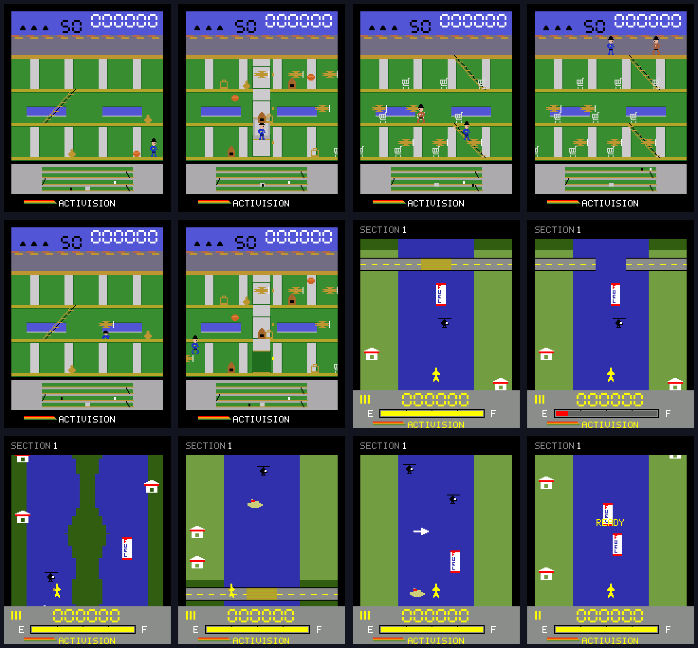

# Keystone Kapers and River Raid — Atari 2600 research and implementation

Research checked on 2026-10-11. Target: the existing ESP32-WROVER arcade,
176×220 ILI9225 display, 60 Hz simulation, eight-button controls.
The two new games use stable catalog slots 50 and 51; earlier scores and favorites survive.
These are native C++ recreations. They do not run cartridge ROMs or emulate the TIA.

## Sources and version selection

- [Activision's Keystone Kapers manual, archived by AtariAge](https://www.atariage.com/manual_html_page.php?SoftwareLabelID=261).
- [Activision's River Raid manual, archived by AtariAge](https://www.atariage.com/manual_html_page.php?SoftwareLabelID=409).
- [Thomas Jentzsch's annotated River Raid disassembly](https://github.com/johnidm/asm-atari-2600/blob/master/riverraid.asm).
- [Atari 2600 Keystone Kapers starting-screen reference](https://pixelatedarcade.com/screenshots/36276).
- [Atari 2600 River Raid bridge-screen reference](https://www.pixelatedarcade.com/screenshots/37501).
- [User-supplied video](https://www.youtube.com/watch?v=iZBFajX_FuE): web retrieval failed;
  its frames and contents have **not** been verified. No claims of video comparison are made.

The manuals describe the Atari 2600 editions. Atari 5200, computer, MSX and
River Raid II editions must not be mixed into this specification.

## Keystone Kapers rules

The manual specifies running, jumping, ducking, entering an open lift with Up,
and exiting with Down. Lifts serve three shop floors; upward escalators alone
reach the roof. The security map tracks Kelly, Harry and the lift.
Radio, ball and cart collisions cost nine seconds; aircraft, timeout and roof
escape lose a character. Bags and cases award 50. Arrests 1–8 award remaining
whole seconds ×100; 9–16 ×200; later arrests ×300. Each 10,000 points adds
a reserve, capped at three. The initial active officer has three reserves.

Implementation: three horizontally paged shop floors and a roof, 50-second
rounds, animated lift stops/travel, upward rides, a reversing fugitive,
jump/duck hitboxes, loot, bounded hazards, immunity after penalties,
arrest and loss transitions, continued score play beyond round twelve.
Keystone ignores the console difficulty setting, following the original manual.

The native hazard schedule is explicit and reproducible:

| Arrest round | Hazards on each shop floor |
| --- | --- |
| 1 | Low bouncing ball |
| 2 | Ball and stationary radio |
| 3 | Ball, radio and cart |
| 4–5 | Those hazards plus a biplane |
| 6 | Higher bouncing ball |
| 7–9 | Two carts |
| 10–12 | Two biplanes |
| 13–15 | Three carts |
| 16 onward | Three biplanes; bounded maximum speeds |

This schedule and the mall coordinates are reconstruction choices. Their
exact correspondence to every original ROM round has **not** been established.

## River Raid rules and progression

The manual specifies lateral banking, forward acceleration, backward braking,
continuous fire and steerable missiles on novice difficulty. Banks and hostile
objects cause crashes. Fuel drains at a fixed rate; overlapping a depot refills
it, so slower passage collects more. The low-fuel warning begins below one
quarter. Tankers score 30, helicopters 60, depots 80, jets 100, bridges 500.
A destroyed bridge advances the restart checkpoint. Three reserves accompany
the active jet; each 10,000 points adds a reserve, capped at nine.

The annotated disassembly describes 16 blocks per section, each 32 lines,
the last containing a bridge. It identifies seed 0xA814, a 16-bit feedback
register, alternation between straight and island sections, jets from difficulty
three, narrower terrain from five, increasing enemy probability and less fuel,
and difficulty 48 returning to 47. There is no twelve-section campaign ending.

Implementation generates both the current and upcoming sections without heap
allocation, retains checkpoint seeds, reconstructs destroyed objects on retry,
and cycles all 48 difficulty states. Roads retain a visible center opening
after bridge destruction, and destroyed targets produce bounded pixel explosions.
Easy/Medium steer the single missile;
Hard/Nightmare keep its direction fixed. The first section always starts from
the historical seed; changing the console's random seed does not alter it.
The fuel accumulator starts at 65,535, consumes 32 each active tick and gains
512 per overlapping depot tick. Reaching one million displays exclamation marks
and stops this native run. B at the first starter mark selects one or two players;
two-player mode alternates on crashes, with independent scores, lives and checkpoints.
The saved high score uses the better player's result when both squadrons are exhausted.

## Fidelity limits

The requested **exact original version** is not established by this implementation.
The feedback operation, difficulty range and documented rules are reproduced,
but terrain interpolation, object placement, enemy activation, mall layout,
round schedules, sprite masks and timing are reconstructed. In particular,
sharing an LFSR does not prove that this river matches the original sequence
or its reported 57,337 section states.

Sprites are newly authored pixel masks; palette, shop fascia, green walls,
pillars, lift, security display, riverbanks, tankers, helicopters, depots and
seven-segment score treatment follow the references. They are not extracted
cartridge graphics. The portrait LCD changes Atari pixel aspect ratio and
available space. Audio uses the console's existing passive-buzzer events;
it does not reproduce TIA waveforms. Exact equivalence would need a verified
ROM-based emulator or a further validated port of both original kernels.

## Verification and controls

```sh
python scripts/test_host.py
python scripts/preview.py --atari
python scripts/preview.py --atari-states
python scripts/verify.py
```

Host checks cover all 48 river difficulty states, deterministic generation,
fuel refill/drain, scoring, checkpoint retry, bridge destruction, extra lives,
missile and terrain collisions, pause/restart, lift entry/exit, escalators,
roof escape, ducking, nine-second penalties and rounds beyond twelve.
Both games also participate in the catalog-wide lifecycle and clipped-render soak.

Keystone: Left/Right run, A jumps, Down ducks/exits lift, Up enters open lift.
River Raid: Left/Right bank, A fires, Up accelerates, Down brakes; B before takeoff
toggles one/two players. Game selection is locked after the first takeoff.
Menu/Back opens the existing pause menu. Scores and favorites use existing saves.
Hardware frame timing, button feel, buzzer and physical-screen legibility require
device verification; host rendering alone does not establish these properties.


## Gameplay and graphics polish — 2026-10-11

Compared the native renderers with the linked Atari 2600 screenshots and rechecked
Activision's manuals. River targets now remain drawn throughout their collision
and refuelling band instead of disappearing below screen row 166. Missiles stop
at banks and islands; a bridge destroyed in the upcoming section retains its
checkpoint state. Depots have all four stacked FUEL letters, with a red F and blue
UEL, bridge decks have crossbars, banking changes the jet silhouette, and the fuel
gauge has a visible empty track and quarter marks.

Keystone hazard rectangles now use the drawn radio/cart heights and aircraft
width. Jumping onto an escalator preserves the boarding height and shortens the
ride, as described in Garry Kitchen's manual tips. Escalator motion finishes at
its drawn endpoint. Harry reacts to the officer's actual lift position; the map
also follows lift and escalator travel. Idle officers no longer run in place,
jumping has its own leg pose, and arrest text persists for the entire arrest
transition. The three shop floors have equal spacing, with the top storey kept
below the roof. Blue middle-floor windows, pillar edges, moving steps, lift frames,
stop lights and door panels improve readability. Paged sprites are clipped to
the playfield gutters.

The host rule checks export twelve deterministic gameplay scenes, in filename
order: Keystone hazards, moving lift, escalator, roof, ducking, jump/page boundary;
River intact bridge, destroyed bridge/low fuel, islands, section seam, enemy/depot
sprites, and checkpoint retry. They use the actual C++ renderer. These controlled
scenes inspect otherwise hard-to-reach states; they are not recorded playthroughs.
The same checks exercise the fixed gameplay cases and verify the roof and gutters.



These improvements remain a native reconstruction. Final production acceptance
still requires testing button feel, audio, scrolling and frame timing on the
physical LCD; no hardware upload or acceptance is implied by host captures.
